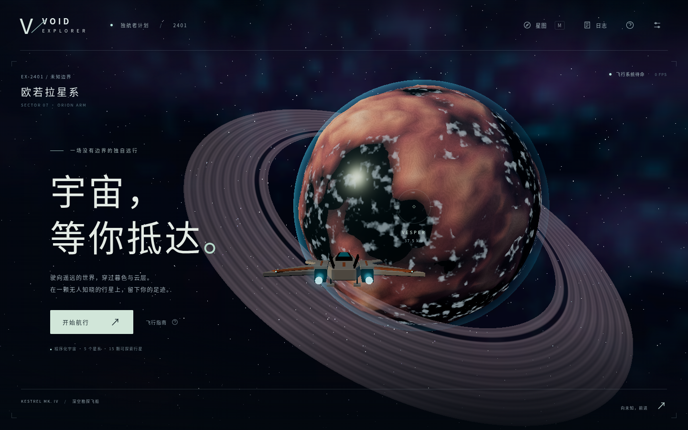

# VOID EXPLORER

一款面向 PC 桌面浏览器的单人 3D 太空探索游戏。驾驶 **KESTREL MK. IV**，穿越行星大气层，着陆、离舱、步行勘探，再返回星空。



## 当前可玩内容

- 5 个星系、15 颗行星，确定性程序化生成地形、半径、配色与环境参数。
- 六自由度飞行、惯性巡航、制动、高速推进和近地速度限制。
- 从太空到行星的连续空间；球形自适应地形与同源碰撞高度。
- 轨道扫描、自动选择附近陆地并下降、着陆、第一人称步行与采样、登舱、起飞。
- 星图、行星航向辅助、跨星系跃迁、探索日志与发现积分。
- 追踪 / 驾驶舱视角、摄影模式、画质设置、程序音效、浏览器自动存档。
- 自制程序化飞船、星空、恒星、星环、海洋、大气光晕、岩石和晶体，无需加载外部模型或媒体。

这是第一版可玩的探索游戏，范围是有限星系目录，尚无战斗、建造、任务剧情或无限宇宙。具体限制与验证范围见 [开发记录](docs/DEVELOPMENT.md)。

## 在云端运行

本项目已在关联的 Codex Cloud 仓库 `/workspace/void-explorer` 中开发与验证，不依赖开发者本地电脑。需要 Node.js 22.12+（验证环境为 24.19）和 npm。

```bash
cd /workspace/void-explorer
npm ci --cache /tmp/void-npm-cache
npm run dev -- --port 5173
```

打开云端环境提供的 5173 端口预览。`http://localhost:5173` 仅指运行服务器的云端机器，不是用户本地机器。

生产版本：

```bash
npm run build
npm run preview -- --port 4173
```

`dist/` 可由任意 HTTPS 静态托管提供。相对资源路径支持子目录部署。图形引擎需要 WebGL 2；鼠标捕获需要 HTTPS 或浏览器认可的本地可信源。

## 开始探索

1. 点击 **开始航行**，再点击画面捕获鼠标；也可以用方向键转向。
2. 按 **F** 扫描初始行星，按 **W** 推进，**X** 制动。
3. 行星足够近时按 **L** 开始自动着陆，约 13 个模拟秒后抵达地表。
4. 按 **E** 离舱，使用 **WASD** 步行，按 **F** 采集地表样本。
5. 返回飞船附近，按 **E** 登舱、**Space** 起飞。
6. 按 **M** 打开星图，点击当前星系的行星对准航向，或选择另一星系跃迁。

| 输入         | 飞行                           | 地表         |
| ------------ | ------------------------------ | ------------ |
| W / S        | 推进 / 降低推进速度            | 前进 / 后退  |
| 鼠标、方向键 | 改变航向                       | 环顾         |
| A / D        | 侧向平移                       | 左右移动     |
| Space / Ctrl | 上升 / 下降；着陆后 Space 起飞 | —            |
| Q / R        | 横滚                           | —            |
| Shift        | 高速推进                       | 奔跑         |
| X            | 制动                           | —            |
| L            | 自动着陆                       | —            |
| E            | 已着陆时离舱                   | 靠近飞船登舱 |
| F            | 扫描行星                       | 地表采样     |
| Tab / T      | 切换目标 / 对准目标            | —            |
| C            | 追踪 / 驾驶舱视角              | 第一人称     |
| M / H        | 星图 / 操作指南                | 同左         |
| P / Esc      | 摄影模式 / 暂停并释放鼠标      | 同左         |

松开 W 后飞船保持惯性巡航。按 S 可以减速至倒退，按 X 快速制动。深水不支持步行；恒星是可接近的实体，但其高温边界会阻止进一步进入。

## 存档与设置

每 5 个活跃模拟秒自动保存；打开菜单和离开页面时也会尝试保存。使用当前浏览器、当前域名的 `localStorage`，无服务器账号。设置中的“重新开始探索”需要再次点击确认。关闭音效或改为低画质可降低负担。

## 开发与验证

```bash
npm test                  # 确定性世界、碰撞、完整探索循环和存档验证
npm run build             # TypeScript + 生产构建
npm run format:check
npx playwright install chromium   # 云端已有 Chromium 时不需要
npm run dev -- --port 5173         # 保持此进程运行
npm run test:e2e                    # 另一云端终端运行
```

浏览器测试可通过 `CHROMIUM_PATH` 指定 Chromium，默认优先使用 `/usr/bin/chromium`，否则使用 Playwright 安装的浏览器。`VOID_URL` 可以覆盖测试服务器地址。截图和报告输出到被 git 忽略的 `test-results/`；交付时精选截图与验收报告保存在 `docs/`。

浏览器测试在开发模式 `?test=1` 暴露可观测接口。键盘、鼠标锁定、导航和菜单走真实浏览器事件；13 秒着陆和 5 秒起飞通过同一模拟器推进时间，并非依靠等待云端软件渲染帧。生产构建不提供此接口。

更多架构、已知限制和下一步见 [docs/DEVELOPMENT.md](docs/DEVELOPMENT.md)。参考体验来自 [OpenAI Showcase / Void Explorer](https://developers.openai.com/showcase/void-explorer)；本项目代码、模型与流程独立实现。
