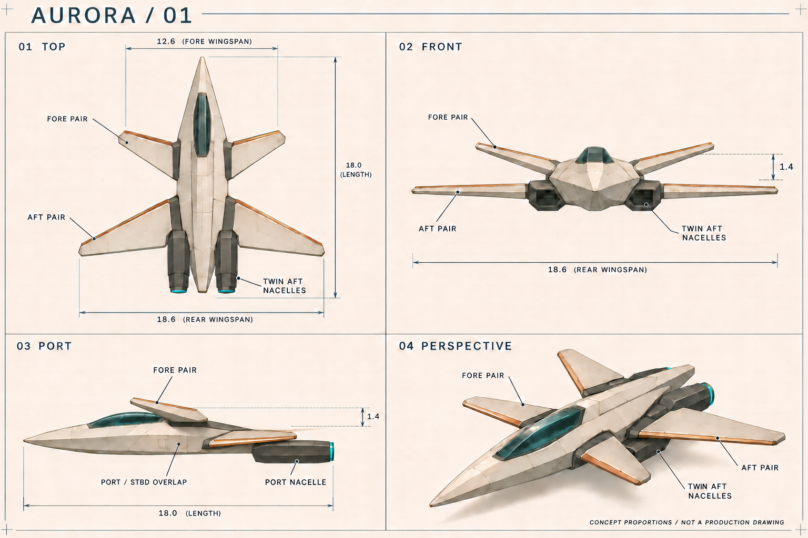

# AURORA / 01 — 四翼探索飞船概念

日期：2026-11-04。状态：**已选定的概念方向，供下一阶段建模讨论；不是精确工程蓝图。**

## 设计方向

采用前短后长、前高后低的四翼串列布局。两个短前翼向前掠，两个长后翼向后掠；每侧两翼之间保留明显空隙，四个独立翼根连接连续机身，避免变成一个十字形。扁长楔形机身、前段低矮座舱与两具尾部推进器构成主轮廓，没有额外尾翼或翼尖发动机。

延续当前游戏的浅灰船壳、深蓝灰结构、铜色边条与青色推进光。饰条用于强调翼面方向，细部保持克制。前短后长的跨度差便于远距离辨认；上下错层使正视图中的四翼也能分开。没有探索其他独立剪影方案，而是对这一方向做了三次结构修正与一次标签修正。

本轮仅在本目录保存概念设计；未创建 Blender 文件、三维网格或运行时资产，未更改游戏、飞船命名、飞行、导航、渲染、世界生成和线上版本。现有游戏仍使用 KESTREL MK. IV；AURORA 是后续设计，不表示已经完成游戏替换。

## 文件与参考视图

| 文件                                                 | 观察方向与用途                                         | 原生尺寸    |
| ---------------------------------------------------- | ------------------------------------------------------ | ----------- |
| [完整母版](originals/aurora-v01-reference-sheet.png) | 四视图整体核对，保留原始生成 PNG 字节及元数据          | 1536 × 1024 |
| [01 顶视图](views/01-top.png)                        | 舰艏朝上；四翼数量、平面布局、机身与座舱轮廓的主要参考 | 724 × 574   |
| [02 正视图](views/02-front.png)                      | 从机头朝后看；四翼高低、展开跨度、座舱和双推进器舱位置 | 789 × 574   |
| [03 左侧视图](views/03-port.png)                     | 舰艏朝左；纵向轮廓、上层前翼、下层后翼和尾部喷口       | 724 × 373   |
| [04 前左上三分之四视图](views/04-perspective.png)    | 四个独立翼面、体积关系、材料和最终识别度               | 789 × 373   |

四张分图是同一最终母版的无缩放、无重绘 PNG 提取，不是各自独立生成的飞船。原图未上采样，不声称具有 4K 细节。裁切范围、逐像素核对结果和 SHA-256 见 [交付清单](sources/asset-manifest.json)。独立分图只方便查看，完整母版仍是原始高质量文件。

## 结构对应与建模约束

定义 `s` 为从鼻尖向尾部增加的纵向距离，`x` 为向右舷增加的横向距离，`h` 为向背部增加的高度。以下为**概念目标尺寸**，并非所有图像像素都精确按此绘制。建模时应统一采用同一组目标值，不分别追踪四张图像产生四套尺寸。

| 结构             | 目标比例或位置                                  | 各视图对应规则                                                 |
| ---------------- | ----------------------------------------------- | -------------------------------------------------------------- |
| 总长             | 18.0 m（比例基准 1.00）                         | 鼻尖到机尾/喷口，不包括推进焰                                  |
| 后翼总展宽       | 18.6 m，约 1.03 倍船长                          | 顶视和正视均为最宽的一对翼面                                   |
| 前翼总展宽       | 12.6 m，约 0.70 倍船长                          | 明显短于后翼，不能加长成同等跨度                               |
| 主机身           | 最大宽约 4 m，低矮、长楔形                      | 保留连续中轴船体，不把翼根间隙画成机身断开                     |
| 唯一驾驶舱       | 舰艏后约 16–43% 船长；长约 4.8 m、宽约 1.2 m    | 深青色单一长座舱，位于上表面，不移到翼间或尾部                 |
| 前翼 F-P / F-S   | 翼根约在 36–52% 船长，上层，翼尖前掠            | 顶视舰艏向上时位于前方；侧视舰艏向左时翼尖必须位于翼根前方     |
| 后翼 A-P / A-S   | 翼根约在 61–81% 船长，下层，翼尖后掠            | 翼尖纵向位置在尾部喷口之前，不延伸到喷口之后                   |
| 前后翼高度差     | 约 1.4 m 的视觉目标                             | 图中箭头表达错层意图；精确翼根平面、上反角仍需二维定线         |
| 推进器 E-P / E-S | 仅两具，横向中心约 x = ±1.8 m；位于机身尾段两侧 | 深色独立舱体，喷口朝后；正视所见为舱体前端，不是向前喷射的尾焰 |

P = 左舷 PORT，S = 右舷 STARBOARD。顶视图左边为 P，右边为 S；正视图面向机头，画面左右与顶视图相反。透视图近侧为 P，远侧为 S。

**侧视图的数量解释：**严格左侧投影中，右舷前后翼与左舷对应翼面重合，右舷推进器也会被近侧遮挡。图中 `PORT / STBD OVERLAP` 是这一投影说明，不是少画了一对翼；不要为“数到四个”额外添加翼面。顶视、正视和透视图用于确认四翼数量，侧视用于核对两个纵向翼位和高低关系。

**一致性人工检查：**最终四视图保留同一艘船的四翼串列布局、单座舱、双尾部推进器和无尾鳍轮廓。检查过前翼前掠方向、后翼尖与喷口的先后关系；侧视已修正初稿中的相反前掠、额外翼状投影和后翼伸出机尾问题。这是图像层面的概念核对，并非经过三维投影求解的几何一致性证明。

## 来源与修改记录

- 工具：`image_gen.imagegen`。初稿从本项目设计约束生成，后续四次都以先前母版为图像参考做局部修正。
- [初稿](review/01-initial-sheet.png)：保留供追溯；侧视前翼方向和尺寸文字存在错误，**不作为建模参考**。
- [第一次修正](review/02-intermediate-sheet.png)：修正前翼方向、删除多余翼状投影，统一 12.6 / 18.6 / 18.0 标注；后翼纵向位置仍需修正。
- [第二次修正](review/03-side-tail-correction.png)：使后翼尖位于推进器喷口之前；随后继续校正侧视翼位。
- [第三次结构修正](review/04-registered-sheet.png)：进一步将侧视前翼前移，收拢后翼侧投影。
- 最终母版：将侧视指向推进器舱的错误标签改为 `PORT NACELLE`。最终采用本页 `originals/` 与 `views/`，不混用 `review/` 的旧图。
- [完整生成与修正提示词](sources/generation-prompts.json)；[机器可读设计约束](sources/design-spec.json)。提示词是本项目自行撰写，不是官方公开的完整原始提示词。
- [官方效果参考](https://developers.openai.com/showcase/void-explorer)：2026-11-04 可访问；用于了解四翼 AURORA 与游戏视觉语境，没有复制其代码、图片作为本项目资产，也没有采用其回顾流程作为强制工作流。
- 当前游戏视觉参考：[第三轮实际截图](../../docs/round3/after/render-orbit.png)与 `src/visuals.ts` 中的现有飞船配色和结构。设计为本项目重新生成。

## 尚存歧义与 Blender 前的确认

1. **精准轮廓与横截面：**生成图仍含局部线宽、厚度和纵向比例偏差，不能像 CAD 蓝图一样逐像素对齐。建议先用本页比例约束统一二维三视定线，明确鼻部、座舱后段及发动机处横截面，保留四翼和双推进器的拓扑。
2. **高度与翼根连接：**图中的 1.4 m 是错层意图；需要确定前翼上反角、各翼根厚度、前后翼准确站位和主机身总高度。画中的柔和阴影不提供背面结构数据。
3. **绝对尺度与座舱：**18 m 是本轮提出的名义尺寸，尚未与现有游戏单位、人物尺寸、驾驶舱视点和舱门净空做实体校核。建议先确认尺度及座舱容量，再开始 Blender。
4. **底部与着陆结构：**本轮未设计底视、起落架、登船口、舱内及内部机构。模型阶段前需确认它们的占位和地面间隙；不要从机腹阴影中推断已存在的结构。
5. **材料与游戏可读性：**方向已选浅灰/铜/深青/青光；精确色值、发光强度、面板分区和远景辨认仍需后续在真实游戏光照下验证。本轮没有替换模型或进行集成测试。

本轮完成的是可审查的概念设计包。上述未定事项不应被描述成已经完成的三维建模、工程结构验证或玩家可见的新资产。
