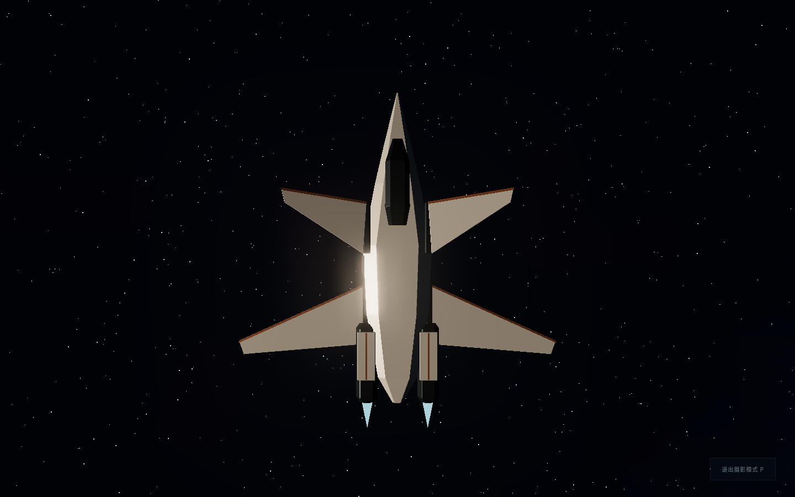
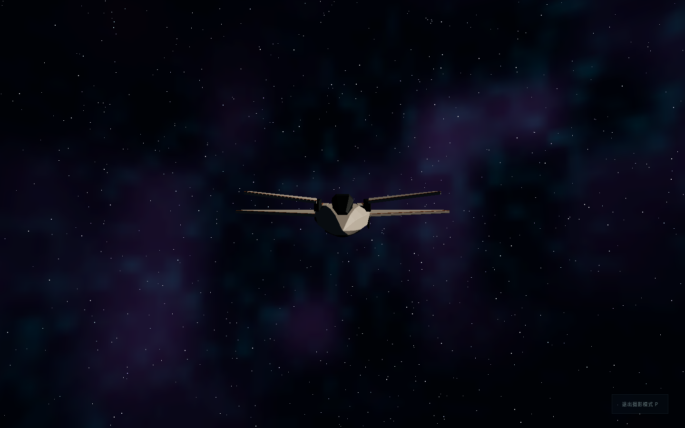
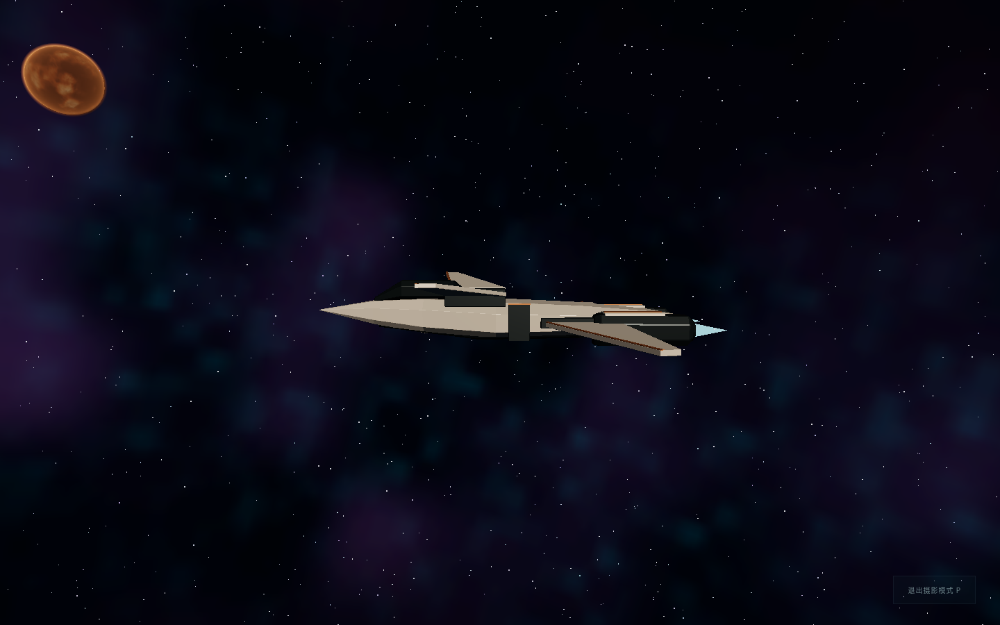
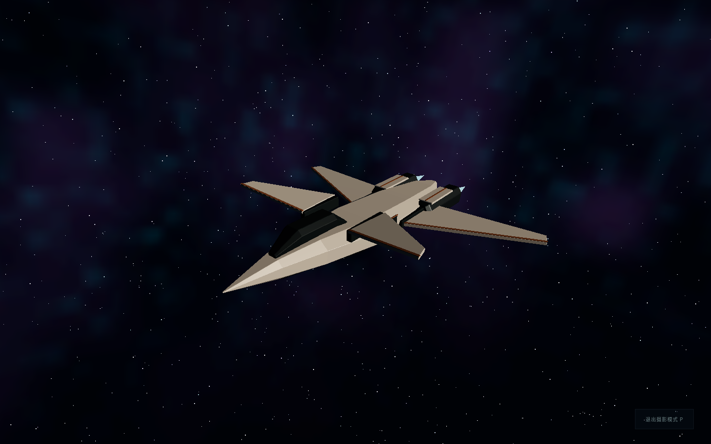
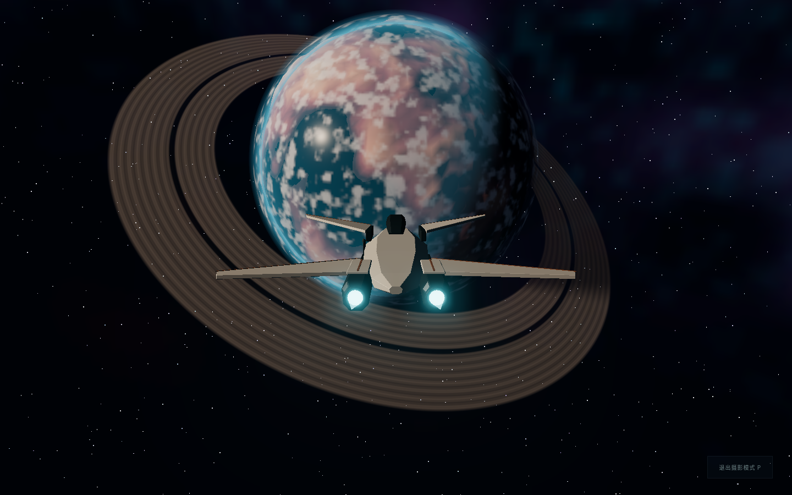

# AURORA 三维建模与游戏集成

本轮基于第四轮 `645ba3a` 和 Draft PR #4，新增 `feat/aurora-integration` 增量分支。目标是将概念变成实际可驾驶的玩家飞船；前四轮概念、代码、PR 与旧在线版本保留，不合并历史 PR。

## 已完成的模型与集成

Blender 4.3.2 在云端实际运行。通过 [构建脚本](../assets/aurora/build-aurora.py) 创建并保存 [原生源文件](../assets/aurora/aurora.blend)，重新打开源文件并经 [独立导出器](../assets/aurora/export-aurora.py) 导出 [游戏 GLB](../assets/aurora/aurora.glb)。完整坐标、零件命名、编辑方法和几何决策见 [资产说明](../assets/aurora/README.md)。

四翼、前短后长、高低错层、楔形机身、单座舱、双尾部推进器与浅灰/铜/深青/青光对应最终概念。补全了截面、翼根、厚度、上反趋势、机腹、四点起落架及左舷舱口/台阶占位。使用统一三维几何解决生成概念图的投影误差，没有逐像素追踪互相矛盾的细部。

游戏通过 Three.js `GLTFLoader` 加载本地导出资产，Vite 构建时生成带哈希的相对 URL，支持 `/aurora/` 预览子路径。原运行时程序化 KESTREL 几何已移除；UI 名称改为 AURORA。资源加载完成前禁用开始按钮；失败时明确提示刷新重试，状态接口保留错误，不暗中回退旧飞船。`rendering.ready` 还要求 AURORA 至少经过一帧实际渲染提交。

推进焰使用两个导出喷口节点；着陆/步行时关闭。起落架在降落时展开、起飞时收起；地面状态下四个支柱按邻近地表高度作有限伸缩。没有新增物理推进、舱内步行或开门动画。

## 必要的尺度、镜头和碰撞调整

- 米制模型以 0.1 缩放映射到原游戏单位。保留原有 6.1 m 着陆基准，通过模型内偏移让脚垫接地；存档版本仍为 1，保存格式未改。
- 跟随距离从旧模型约 170 m 调到约 47 m，使 18 m 飞船在屏幕上保持可读。导航回归中原先写死旧距离的断言改为检查实际模型船长比例及稳定距离，没有删除真实远航断言。
- 驾驶舱视点读取模型挂点；镜头进入驾驶舱或步行模式时近裁面改为 8 cm，避免近距离船壳截断。近地驾驶舱镜头地表保护降到眼高，防止旧 6 m 保护线把视点抬出座舱。
- 出口改为左舷挂点水平位置，地表眼高保持 1.8 m；登船范围从旧 70 m 改为约 12 m。加入机身/发动机的粗略二维步行阻挡，避免走穿新船体。
- 近地中心防撞间隙从 8 m 增到 14 m，以覆盖新模型相对原基准的几何半径。仍采用既有地表径向保护，不等于逐三角形飞船/地形刚体碰撞。
- 加速、惯性、转向、巡航、星图与导航参数没有改动；`src/navigation.ts`、程序宇宙和行星渲染逻辑保持原样。`src/visuals.ts` 的改动仅移除旧飞船类和其专用几何辅助函数。

## 游戏内证据

以下为实际 WebGL 游戏画面。检查视角通过开发态相机预设调用同一个游戏场景和渲染器，不是 Blender 离线渲染，也不是图像生成器绘制。

| 检查视角               | 实际游戏截图                     |
| ---------------------- | -------------------------------- |
| 顶视：四翼和纵向间隙   |      |
| 正视：高低错层         |    |
| 左侧：机腹和纵向结构   |     |
| 前左上透视：体积与材质 |  |
| 后视：双喷口与推进焰   |     |

[旧模型正常飞行画面](aurora/before-flight.png)与[新模型真实飞行](aurora/real-flight.png)保留作视觉参考；镜头已按船长调整，不把这两张不同镜头覆盖范围的画面当作受控性能比较。

[真实下降](aurora/real-descent.png)、[真实着陆](aurora/real-landed.png)、[离舱](aurora/real-disembark.png)、[驾驶舱](aurora/real-cockpit.png)、[真实起飞](aurora/real-takeoff.png)、[大气场景](aurora/game-atmosphere.png)、[固定地表场景](aurora/game-surface.png)。

## 可复现检查

```bash
npm ci --cache /tmp/void-npm-cache
npm run build
npm test
npm run dev -- --port 5173
# 另一个云端终端，按顺序运行，避免同时争用软件图形设备
npm run test:e2e
npm run test:navigation
npm run test:aurora
npm run test:rendering
npm run test:render-flight
# 另起 npm run preview -- --port 4173 后
npm run test:production
```

- 逻辑与资产检查读取实际 GLB，验证四个有几何的翼面、双推进器、尺寸、前后翼关系、脚点、挂点、船体包络和左右舷出口。Blender 导出器检查所有导出零件的非流形边；不是仅检查元数据声称的数量。
- AURORA 浏览器检查首先单独注入损坏资产，验证错误状态与禁止开始，然后从全新正常出生点执行真实 W/X、C、L、E、步行、F、存档重载、E、Space；这一流程没有场景定位或模拟时间快进。
- 流程后再明确切换为固定场景，拍摄五个飞船观察角度及大气、地表画面。每个观察角度暖机 14 帧后记录数据；固定场景不当作真实飞行抵达的证据。
- 生产冒烟检查读取浏览器收到的 GLB，比较源码导出的 SHA-256，并继续确认开发接口不存在、测试查询被忽略和真实操作正常。
- 继续运行原有探索、真实导航和渲染回归。界面截图、状态、控制台错误与性能观测归档于本报告旁的 `docs/aurora/`，CI 也上传完整浏览器证据。

本轮云端实际通过：35 项逻辑/资产测试、15 项探索检查、16 项导航检查、9 项生产检查、6 组 AURORA 浏览器检查、8 个固定渲染场景，以及原有真实时间下降闭环。正常流程没有 JavaScript/控制台错误；损坏 GLB 是单独隔离的负向用例。各套件报告见 [AURORA 流程](aurora/asset-browser-report.json)、[探索](aurora/exploration-report.json)、[导航](aurora/navigation-report.json)、[生产](aurora/production-report.json)、[渲染](aurora/rendering-report.json) 和 [真实下降](aurora/render-flight-report.json)。

真实着陆样本的四个接点中心，对程序碰撞地表的最大半径差低于 1 cm；该点可见地形与碰撞地表的中心射线差约 1.1 mm。这不保证脚垫角点或所有着陆点都达到此精度。另有 [近地驾驶舱针对性检查](aurora/landed-cockpit-report.json)：明确使用 `step(14)` 定位地面后按 C，证实旧 6 m 镜头保护线没有将视点抬出座舱；它与真实时间闭环分开记录。

## 成本与限制

实际资产为约 164 KB、2,584 三角形、29 个网格图元、6 种材质，没有资产贴图；飞行状态会隐藏起落架和台阶。GLTFLoader 增加了解析代码，但没有增加第三方运行时依赖或压缩解码器。

云端使用 Linux Chromium 与强制 ANGLE SwiftShader。帧间隔、CPU 更新和渲染提交计时包含软件光栅化与调度，**不能作为 Windows/macOS 实体 GPU 帧率结论**。各检查视角的星空/行星覆盖不同，也不能互相当作同场景性能对照。第三轮已有的大气/近景软件渲染成本没有被本轮解决。

| 固定检查视角 | 云端 RAF 中位间隔 | 全场景绘制调用 | 全场景三角形 |
| ------------ | ----------------: | -------------: | -----------: |
| 顶视         |            500 ms |             37 |        3,634 |
| 正视         |            400 ms |             37 |        3,634 |
| 左侧         |            533 ms |             62 |       25,010 |
| 透视         |            433 ms |             37 |        3,634 |
| 后视         |            583 ms |             65 |       86,258 |

以上来自 1440×900、DPR 1、中画质，包含后处理和环境。首个正常出生样本从飞船对象创建到模型挂载约 3.18 s，包含游戏启动期间主线程阻塞，不能称作独立的 GLB 网络或解码耗时；也不包括 GPU 首帧验收。原始数据和限制见 [验证摘要](aurora/verification.json)。这些软件帧间隔明显较长，不能据此宣称桌面已经流畅验收。

四支柱只是有上下限的几何伸缩，不是带载荷的悬挂仿真；极端坡地、突出岩石、任意机身下方地形和所有行星着陆点未全面验证。步行阻挡是粗略机身/发动机包络，未为每个翼面、支柱或台阶实现刚体碰撞。机腹净空低于人眼高；登船通路位于左舷翼根间，不能视为已建成可穿行的内部舱室。

驾驶舱沿用现有仪表覆层，玻璃是可读性优先的不透明 PBR 表面，没有完整内饰、透明玻璃折射或飞船自身投影阴影。Safari/Firefox、实体 GPU、长期运行显存及低端桌面硬件仍需实机检查。

## 预览与历史

本轮使用独立 `/aurora/` 预览；实际部署来源以预览的 `build-info.json` 和 PR 中的发布记录为准。默认入口保留第二轮，`/round1/` 和 `/round3/` 均保留。没有擅自合并任何 Draft PR。
