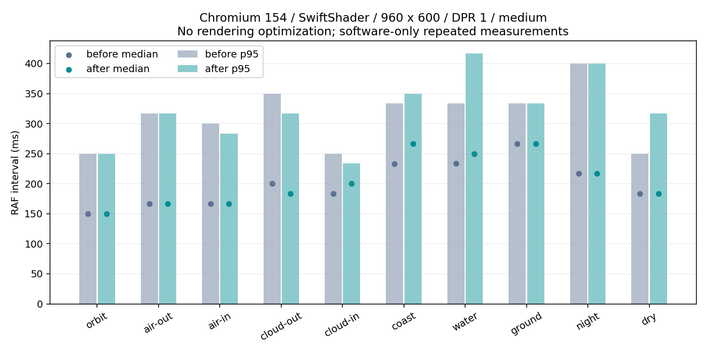
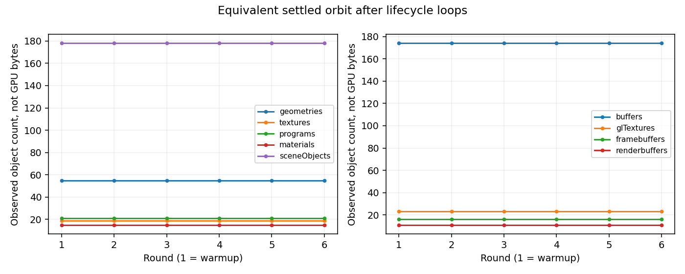

# 工程优化03：性能、兼容性与长期稳定性补强

> 本文记录本轮实际执行结果；所有数字以 `engineering-03/verification.json` 和所链接的原始记录为准。Linux 软件渲染不等于真实设备验收。

## A. 执行摘要

完成 2 组存档问题修复（原文防覆盖、异常状态与进度恢复）及 1 项开发依赖链修复；没有提交推测性性能优化或无证据的资源释放改动。最终 85 项单元、全部原有本地浏览器回归和远端完整 CI 通过；10/10 固定截图逐像素一致，6 轮资源循环计数稳定。硬件长测、不可启动的浏览器及海岸软件 RAF 观察项仍明确保留。

本轮保留飞行、导航、世界生成、材质、光照、AURORA、音频和默认画质。生产行为改动限于存档读取/恢复/保护；开发依赖仅升级 Vitest 依赖链。复用已有 `window.__VOID__`、固定场景和真实旅程测试，补充有界采样、GL 对象计数、设备验证和人工长测记录工具。

不实施没有测量收益证据的渲染优化，不迁移引擎，不部署。真实 Windows/macOS GPU、Safari、物理输入与 30–60 分钟探索验收仍需要用户设备。

## B. 基线与环境

- 仓库：`MKC-Mankii/void-explorer`；指定基线：`8a858eb55a3750c1a6c762ac3d3be73695758f96`。
- `fix/engineering-02` 经远端 SHA 和 PR #8 元数据双重核对，仍为该 SHA；#8 为 open、draft、未合并，目标 `feat/world-coherence`。
- 只读保护：`feat/world-coherence = 4b35a4cd9d307533b90c43ad674b44401a5e2e26`；`main = d6948844b1de26b1237cce3ceaf753b9dd964775`；`gh-pages = b6d59d01e8ad860708aa2fc676c94a1ca93dae17`。
- 云工作区初始为干净的 `work` / 初始提交。获取指定分支后从精确 SHA 新建 `feat/engineering-03`，没有覆盖用户文件或移动原分支。
- 在线 `/coherence/build-info.json` 声明相同 source commit；这是既有工程02发布记录，不表示本轮部署。本轮核实发布来源元数据，没有重新构建并逐字节认证线上全部资产。试玩 URL 的 `?v=` 本身不是来源证据。
- Linux x86_64 / kernel 6.18.57；AMD EPYC 9V45 虚拟 CPU，5 个逻辑核，约 18.88 GB 可见内存；不是实体独占设备。
- Node 24.19.0，npm 11.9.0；远端 CI 使用 Node 22。Chromium 154.0.8037.57，强制 ANGLE SwiftShader。完整 renderer/vendor/extensions 位于采样报告。
- 性能：960×600 CSS、DPR 1、medium；固定场景截图：1280×800、DPR 1、medium。不同分辨率的结果不能横向混用。

锁文件实际版本（不是 package.json 的范围）：

| 包                 | 基线    | 本轮    |
| ------------------ | ------- | ------- |
| `three`            | 0.180.0 | 0.180.0 |
| `@playwright/test` | 1.64.1  | 1.64.1  |
| `@types/node`      | 22.20.5 | 22.20.5 |
| `@types/three`     | 0.180.0 | 0.180.0 |
| `prettier`         | 3.9.10  | 3.9.10  |
| `typescript`       | 5.9.3   | 5.9.3   |
| `vite`             | 7.3.7   | 7.3.7   |
| `vitest`           | 3.2.7   | 4.1.12  |
| `@vitest/mocker`   | 3.2.7   | 4.1.12  |
| `tinypool`         | 1.1.1   | 移除    |

## C. 性能基准

固定场景沿用已有 `coherence-*`，覆盖轨道、大气内外、云层内外、海岸、水面、地表、夜侧和干燥行星。每场景先 `scenario` + `step(0)` 固定姿态，然后预热 30 个渲染帧，再持续采样 30 秒，重复两次。固定场景不冒充玩家实际飞行。基线副本仅增加与本轮相同的诊断采样，不包含存档修复；对应补丁保存为 `engineering-03/baseline-instrumentation.patch`。

原工具最后 8 帧的截图附带时序不足以作为性能基准；仍保留其截图职责。新增采样分开记录 RAF、CPU 更新、模拟、场景同步与渲染提交，报告样本数、中位数、p95、最差值和原始样本。计时不调用 GPU timer query，GPU 时间为 null；扩展存在不意味着已测 GPU。`performance.now()` 包围提交时间不是 GPU 执行时间，FPS 不能代替分布。

采样最多保留 12,000 帧，避免诊断无限占用内存。真实旅程采样沿用原有输入和断言，记录下降/步行、起飞/离开大气、海岸飞行；不改变模拟、不新增固定位置操作。长旅程发生刷新时分段记录。性能对比必须使用同版本浏览器、分辨率、DPR、画质与预热设置。

固定场景两个版本各执行 20 次稳定采样，每次 30 秒；下表合并同场景两轮的原始帧计算分位数，非平均 FPS。完整分轮、CPU、GPU null、资源和设备字段见 [性能汇总](engineering-03/performance-summary.json) 与 [原始证据](engineering-03/evidence/engineering-03/)。

| 场景                | 基线 n | 基线 median / p95 / worst ms | 本轮 n | 本轮 median / p95 / worst ms |
| ------------------- | -----: | ---------------------------- | -----: | ---------------------------- |
| coherence-orbit     |    412 | 149.9 / 250.0 / 400.0        |    408 | 149.9 / 250.0 / 516.6        |
| coherence-air-out   |    350 | 166.7 / 316.6 / 500.0        |    338 | 166.7 / 316.7 / 433.3        |
| coherence-air-in    |    343 | 166.7 / 299.9 / 450.0        |    338 | 166.8 / 283.3 / 549.9        |
| coherence-cloud-out |    301 | 200.0 / 350.0 / 400.0        |    309 | 183.4 / 316.7 / 416.7        |
| coherence-cloud-in  |    315 | 183.4 / 250.0 / 449.9        |    307 | 200.0 / 233.4 / 416.7        |
| coherence-coast     |    256 | 233.3 / 333.3 / 600.0        |    230 | 266.5 / 350.0 / 533.3        |
| coherence-water     |    254 | 233.4 / 333.3 / 516.7        |    241 | 249.9 / 416.6 / 766.7        |
| coherence-ground    |    230 | 266.6 / 333.3 / 533.3        |    228 | 266.6 / 333.3 / 649.9        |
| coherence-night     |    268 | 216.7 / 399.9 / 616.7        |    273 | 216.7 / 400.0 / 716.6        |
| coherence-dry       |    321 | 183.3 / 250.0 / 366.7        |    326 | 183.3 / 316.7 / 783.4        |



没有提交任何渲染提速改动，因此这些差异仅为同环境回归和波动观察，不作为优化收益。云 CPU 非独占；基线首轮期间有短时构建/依赖准备活动，异常尾部不能全部归因于游戏。两轮不足以建立实体 GPU 性能承诺。环境实际提供 `EXT_disjoint_timer_query_webgl2`，但本轮没有 GPU 查询采样实现，故所有 GPU 时间明确为 null。

| 场景                | CPU update median / p95 ms（前 → 后） | scene median ms（前 → 后） | submit median ms（前 → 后） | draw calls / triangles（前 → 后） |
| ------------------- | ------------------------------------- | -------------------------- | --------------------------- | --------------------------------- |
| coherence-orbit     | 0.70/1.00 → 0.70/1.00                 | 0.40 → 0.40                | 0.80 → 0.80                 | 59/39731 → 59/39731               |
| coherence-air-out   | 0.70/1.10 → 0.70/1.10                 | 0.40 → 0.40                | 1.30 → 1.30                 | 154/105661 → 154/105661           |
| coherence-air-in    | 0.70/1.00 → 0.70/1.20                 | 0.40 → 0.40                | 1.30 → 1.40                 | 154/105701 → 154/105701           |
| coherence-cloud-out | 0.70/1.10 → 0.70/1.00                 | 0.40 → 0.40                | 1.50 → 1.40                 | 172/118281 → 172/118281           |
| coherence-cloud-in  | 0.70/0.90 → 0.70/1.10                 | 0.40 → 0.50                | 1.40 → 1.50                 | 173/118931 → 173/118931           |
| coherence-coast     | 0.80/1.20 → 0.80/1.10                 | 0.50 → 0.50                | 1.90 → 2.00                 | 258/174381 → 258/174381           |
| coherence-water     | 0.90/1.40 → 1.00/1.40                 | 0.70 → 0.70                | 2.00 → 2.20                 | 224/148431 → 224/148431           |
| coherence-ground    | 1.00/1.60 → 1.00/1.50                 | 0.70 → 0.70                | 2.30 → 2.20                 | 299/195337 → 299/195337           |
| coherence-night     | 0.80/1.60 → 0.80/1.30                 | 0.50 → 0.50                | 1.70 → 1.80                 | 195/133271 → 195/133271           |
| coherence-dry       | 0.80/1.20 → 0.80/1.50                 | 0.50 → 0.50                | 1.80 → 1.80                 | 175/98525 → 175/98525             |

模拟阶段在冻结场景中接近零，这是固定姿态的预期结果，不能当作活动飞行模拟成本；活动阶段见 `evidence/coherence/journey/report.json.gz` 的 `performanceStages`。

同浏览器重新采集了基线与本轮各 10 张截图。像素比较：10/10 张逐像素一致；最大整图平均 RGB 差为 0.000000/255。详情见 [像素比较](engineering-03/visual-comparison.json)，基线/本轮 PNG 在 `screenshots/`。本次这些固定姿态没有像素差异；此结论不扩展为所有动态画面或所有平台均完全一致。

动态旅程为每版单次连续操作记录（原有测试最后切到 low，1280×800 CSS、实际像素比 0.75），不与 medium 固定场景混用，不称为稳定 30 秒基准；不同 RPC 输入时刻也不能当作严格逐帧同步。

| 真实阶段                | 基线 n / median / p95 / worst ms | 本轮 n / median / p95 / worst ms |
| ----------------------- | -------------------------------- | -------------------------------- |
| flight-descent-walking  | 187 / 133.3 / 366.7 / 483.3      | 184 / 133.3 / 333.2 / 500.0      |
| takeoff-exit-atmosphere | 96 / 100.1 / 216.7 / 349.9       | 98 / 100.0 / 216.6 / 400.0       |
| coastal-flight          | 52 / 183.3 / 333.4 / 450.0       | 54 / 166.7 / 350.0 / 433.3       |

海岸专项复核：初始顺序测试中基线中位数约 233/233 ms，本轮约 250/267 ms。CPU 更新、渲染计数和截图相同仍不足以解释 RAF 差异，故增加交替 A/B（每次独立浏览器、30 帧预热、30 秒采样），保留全部数据：

| 顺序 | 版本   |   n | median / p95 / worst ms |
| ---- | ------ | --: | ----------------------- |
| 1    | before | 132 | 216.7 / 366.6 / 433.4   |
| 2    | after  | 130 | 233.3 / 416.6 / 616.7   |
| 3    | before | 131 | 233.3 / 350.0 / 450.0   |
| 4    | after  | 128 | 233.3 / 266.7 / 450.0   |

交替复核的本轮两次中位数均回到 233.3 ms，基线为 216.7/233.3 ms，初测本轮的 250/267 ms 未稳定重现。这组小样本仅缩小了复核范围；不据此宣称性能提升，也不将全部差异无依据地归为噪声。海岸 RAF 差异保留为待真实 GPU/更长交替实验核实的观察项，未据此降低画质或修改渲染。

## D. 改动决策与风险登记

| 发现                                           | 分类与证据                                                              | 决策                                                            | 风险/回滚                                                               |
| ---------------------------------------------- | ----------------------------------------------------------------------- | --------------------------------------------------------------- | ----------------------------------------------------------------------- |
| 异常存档被当作无存档，随后自动保存可能覆盖原文 | 已确认缺陷：原读取函数捕获 JSON/存储异常后直接返回 null，保存路径无保护 | 独立 `SaveStorage`，先保留原文再替换，备份失败不写主键          | 只在异常恢复时增加备份；合法当前存档路径保持原有单键保存                |
| 星系索引类型、中心位置和异常残留运动可被恢复   | 已确认缺陷：新增边界测试在基线失败，原始失败日志保留                    | 读取时验证物理状态，已知 v1 进度保留，安全回退；不改变飞行 tick | 校验仅针对无法由正常游戏产生的状态；合法行走/着陆、旧版往返测试约束回归 |
| Vitest/mocker/tinypool 公告                    | 有证据支持的开发链风险；不等于生产游戏漏洞                              | 最低同时覆盖两项 mock 公告的维护版 4.1.12，移除旧 tinypool 依赖 | 主版本升级需完整 CI；可独立回滚依赖提交，但会恢复告警                   |
| CPU 热点/渲染性能优化                          | 未证实可获得超出波动的收益                                              | 不改渲染算法、LOD 参数、对象细节或画质                          | 无推测性优化需要撤销                                                    |
| 长期 GPU 内存/驱动兼容                         | 已知验证限制                                                            | 可运行的设备脚本和长测记录入口                                  | 不能用 JS heap 或 GL 对象数量代替显存                                   |

## E. 兼容性与设备验证

| 环境                                                 | 实际结果                                                               | 限制                    |
| ---------------------------------------------------- | ---------------------------------------------------------------------- | ----------------------- |
| Linux / Chromium 154 / SwiftShader                   | passed；18 组尺寸/DPR/画质组合，5 组检查，无非预期页面错误             | 软件 GPU，不能外推硬件  |
| Firefox（已下载 Playwright 构建）                    | 启动失败，profile folder 错误；默认和显式 profile 均尝试               | 不算平台通过            |
| WebKit（已下载 Playwright 构建）                     | 启动失败：缺 libgtk-4、graphene、harfbuzz-icu、manette、hyphen、GLESv2 | 不算 WebKit/Safari 通过 |
| Windows / macOS / 硬件集成或独立 GPU / Safari / Edge | 未执行，待真实设备                                                     | 工具存在不代表平台通过  |

详见 [设备短测](engineering-03/evidence/engineering-03/compatibility/report.json.gz) 和 `browser-probes-installed.json`、`firefox-profile-probe.json` 原始启动错误。

WebGL 上下文丢失的现有恢复设计是保存并提示刷新；本轮验证的是刷新后图形和进度恢复，不声称自动原地恢复。GLB 失败测试显式阻断资源，确认开始按钮禁用、存在恢复文案，撤销故障后刷新成功；该测试的预期资源错误与非预期页面错误分开记录。

自动化指针捕获/右键和合成 blur 不等于真实 macOS Control-click 或操作系统窗口切换。WebKit 的 Linux 自动化构建也不等于 Safari，即使能启动也不能代替 Safari 验收。

## F. 资源生命周期与长时间稳定性

短版循环包含大气/云层/海岸往返、两颗行星、着陆/离船/采样/登船/起飞、多个星系跃迁、质量切换、resize、暂停恢复。固定位置和加速 `step` 明确属于生命周期压力测试；真实连续下降与探索另由原有浏览器旅程测试执行。

每阶段记录 Three geometry/texture/program、场景对象、可遍历 Mesh 的唯一材质数（不含后处理及 Sprite 材质）、地形 mesh 缓存/待生成任务、JS heap（可用时）、GL Buffer/Texture/Framebuffer/Renderbuffer/Program/Shader 创建/删除/存活代理计数。WeakSet 代理不强引用 GL 对象；计数是 API 层对象，不是驱动分配或字节数。render target 用 GL framebuffer/renderbuffer 代理观察，没有声称直接统计 Three render target 实例。JS heap API 可能量化或含共享统计，未作为精确内存/泄漏断言。pending 仅包含地形 queued 及模型/跃迁就绪信号，不包含浏览器全部异步任务。首轮用于预热，后续比较同一个稳定轨道状态，不能要求所有资源归零。

最终短测状态：**passed**；6 轮，3.29 分钟，72 个阶段快照，0 个非预期错误。每轮 2 次真实 UI 跃迁，共 12 次；同时覆盖 fixture 流送与加速着陆循环。

| 轮  | geometry | texture | program | material | scene objects | GL buffers | GL textures | framebuffers | renderbuffers | JS heap bytes |
| --- | -------: | ------: | ------: | -------: | ------------: | ---------: | ----------: | -----------: | ------------: | ------------: |
| 0   |       55 |      19 |      21 |       15 |           178 |        174 |          23 |           16 |            11 |      22440619 |
| 1   |       55 |      19 |      21 |       15 |           178 |        174 |          23 |           16 |            11 |      24323463 |
| 2   |       55 |      19 |      21 |       15 |           178 |        174 |          23 |           16 |            11 |      22897260 |
| 3   |       55 |      19 |      21 |       15 |           178 |        174 |          23 |           16 |            11 |      51131958 |
| 4   |       55 |      19 |      21 |       15 |           178 |        174 |          23 |           16 |            11 |      22562627 |
| 5   |       55 |      19 |      21 |       15 |           178 |        174 |          23 |           16 |            11 |      23255748 |

表内 round 为零起始索引。后续等价状态检查采用原值相等断言，无放宽阈值；只说明已执行循环内可观测资源计数稳定，不是无泄漏或长期显存验收。



数分钟或十余分钟自动循环不称为长期验收；自然 GC 的 JS heap 波动不能独立证明泄漏或无泄漏。30–60 分钟真实设备记录入口见 J。

## G. 依赖安全核实

基线锁定 Vitest 3.2.7、`@vitest/mocker` 3.2.7、tinypool 1.1.1。审计的 3 个受影响包并不是 3 个独立漏洞：本轮共 4 个独立公告，Vitest 条目重复归因于直接公告和传递依赖。

| 公告                | 影响范围 / 修复                                          | 本项目实际路径与触发条件                                                                                                                                                      |
| ------------------- | -------------------------------------------------------- | ----------------------------------------------------------------------------------------------------------------------------------------------------------------------------- |
| GHSA-82fw-gwwq-j7x9 | mocker/Vitest ≥2.1.0、<4.1.11；维护修复 4.1.11           | 根 devDependency Vitest → mocker；公开 mocker/interceptor 插件暴露的 WebSocket 注册路径可读取越界文件。本项目 Vite 配置未启用该插件，CI 是 `vitest run`，非 browser/mock 服务 |
| GHSA-qxg6-89mg-rqv8 | mocker ≥2.1.0-beta.7、<4.1.12；修复 4.1.12（另有 5.0.3） | 同一开发链；攻击者需接触注册 socket，使生成的 mock 模块包含注入代码。不能仅因 `vite --host` 就认为本项目启用了该 mock 插件                                                    |
| GHSA-5gmw-xhrv-c9v3 | tinypool ≤2.1.0；修复 2.1.1                              | Vitest → tinypool；已有上游原型污染是先决条件，worker options 继承 execArgv/env 后触发。不是生产浏览器远程入口                                                                |
| GHSA-85c8-ppgw-ccpr | tinypool <2.1.2；修复 2.1.2                              | 同上；需原型污染加调用者传入 run options，从继承的 filename 重定向 worker。未发现本项目测试向该 options 输入不可信请求                                                        |

公告全文和完整 audit JSON 保存于 `engineering-03/security/`。旧 3.x 不获 mocker 安全回补；直接强行覆盖 mocker 主版本会破坏 Vitest 内部契约，因此选择 Vitest 4.1.12（精确版本），仅更新其依赖闭包。新版本已不依赖 tinypool，因此没有把 2.x 强塞进旧 Vitest。Three、Vite、TypeScript、Playwright、Prettier 及运行时资源版本不变。

升级前生产 `npm audit --omit=dev` 为零；升级后全依赖/生产两次审计均为零。审计仅代表执行时公告数据库结果，不承诺未来零漏洞。没有执行 `npm audit fix --force`。

## H. 存档健壮性与兼容性

继续使用主键 `void-explorer-save-v1`、`version: 1`；不引入新的格式版本或大型 schema 库。字段包括 system、position/rotation、mode、landedPlanet、shipPosition/shipRotation、discoveries、playTime，以及后加入的可选 target/velocity/speed。landing/takeoff 保存为安全 flight，是已有规则。

合法早期 v1 缺失 target/velocity/speed 时补 0 / 零向量；缺失飞行 ship transform 可从玩家 transform 重建。不存在有证据的 version 0 或无版本历史格式，因此不虚构迁移：无版本/未知版本保留原文并安全开始；未来版本禁止覆盖。可修复的目标索引、时间和发现字段按确定性规则归一化，记录 issues；二次读取规范化结果应幂等。

无法恢复的 v1 位置/姿态/物理矛盾回退到该已知星系安全起点，未知星系回到起始星系，所有合法星球的 scan/land/sample 进度尽可能保留。不存在的发现 ID 不变成游戏目录；原始数据仍保留用于诊断。正常着陆/步行的贴地容差及船员/飞船关系由测试覆盖，不把普通误差当损坏。

第一次保存修复结果前，将完整原始字符串写入 `void-explorer-save-v1-recovery`；已有不同备份则使用 `-1` 到 `-19`，不覆盖旧副本。备份写入及读回成功后才写主键。配额不足、备份槽耗尽、读取不可用、其他标签修改了主键时停止保存，继续当前可玩的会话。主键写入中断时原值仍在，或已完成原子替换；备份先于主键保证原文有恢复路径。这里是每键原子写入，不声称跨标签事务隔离。

恢复操作：在浏览器开发者工具 Application/Storage 中导出主键及全部 recovery 键，然后诊断副本。不要把已损坏的备份直接覆盖回主键。配额不足时应先导出，再由用户删除不再需要的旧备份；框架不会自动清空存档。显式两次确认“重置”仍只清除活动进度，诊断备份保留。

最终单元：11 文件 / 85 测试通过（原有 55 + 新增 30）；存档浏览器：9 组 **passed**，包含两次刷新、原文备份与发现进度检查。测试源码为 `save-boundaries.test.ts`、`save-storage.test.ts`、`save-browser.mjs`；原始日志见 `evidence/engineering-03/`。

## I. 完整回归与失败记录

较大的原始 JSON 记录以 `.json.gz` 无损归档，避免将数十万行自动采样数据混入代码审查；完整审计 JSON、日志、汇总和 verification 保持明文。压缩前后逐字节解压验证通过，原始路径、大小、SHA-256 见 [证据清单](engineering-03/evidence-manifest.json)。可用 `gzip -dc <report.json.gz> > /tmp/report.json` 还原；测试入口本身仍输出普通 JSON。

| 命令/阶段                                            | 结果                                           |     秒 | 原始日志                                                                       |
| ---------------------------------------------------- | ---------------------------------------------- | -----: | ------------------------------------------------------------------------------ |
| `npm run test:save-browser` (save-browser)           | 通过                                           |  64.77 | [log](engineering-03/evidence/engineering-03/regression/save-browser.log)      |
| `npm run test:resource-soak` (soak)                  | 等待参数跨浏览器传递错误，已修复并定向复测     | 125.31 | [log](engineering-03/evidence/engineering-03/regression/soak.log)              |
| `npm run test:device` (compatibility)                | 通过                                           |  65.57 | [log](engineering-03/evidence/engineering-03/regression/compatibility.log)     |
| `npm run format:check` (format)                      | 初次原始 JSON 格式失败；最终全仓格式检查已通过 |   5.02 | [log](engineering-03/evidence/engineering-03/regression/format.log)            |
| `npm test` (unit)                                    | 通过                                           |   1.89 | [log](engineering-03/evidence/engineering-03/regression/unit.log)              |
| `npm run build` (build)                              | 通过                                           |   2.60 | [log](engineering-03/evidence/engineering-03/regression/build.log)             |
| `npm run test:e2e` (e2e)                             | 通过                                           |  65.17 | [log](engineering-03/evidence/engineering-03/regression/e2e.log)               |
| `npm run test:navigation` (navigation)               | 通过                                           |  72.26 | [log](engineering-03/evidence/engineering-03/regression/navigation.log)        |
| `npm run test:right-click` (right-click)             | 通过                                           |  21.95 | [log](engineering-03/evidence/engineering-03/regression/right-click.log)       |
| `npm run test:production` (production)               | 通过                                           |   8.29 | [log](engineering-03/evidence/engineering-03/regression/production.log)        |
| `npm run test:engineering-02` (engineering-02)       | 通过                                           |  25.72 | [log](engineering-03/evidence/engineering-03/regression/engineering-02.log)    |
| `npm run test:rendering` (rendering)                 | 通过                                           |  63.21 | [log](engineering-03/evidence/engineering-03/regression/rendering.log)         |
| `npm run test:render-flight` (render-flight)         | 通过                                           |  32.81 | [log](engineering-03/evidence/engineering-03/regression/render-flight.log)     |
| `npm run test:aurora` (aurora)                       | 通过                                           |  96.37 | [log](engineering-03/evidence/engineering-03/regression/aurora.log)            |
| `npm run test:coherence` (coherence)                 | 通过                                           | 141.80 | [log](engineering-03/evidence/engineering-03/regression/coherence.log)         |
| `npm run test:coherence-journey` (coherence-journey) | 通过                                           |  68.48 | [log](engineering-03/evidence/engineering-03/regression/coherence-journey.log) |
| `npm run test:performance` (performance-after)       | 通过                                           | 766.99 | [log](engineering-03/evidence/engineering-03/regression/performance-after.log) |
| `npm run test:resource-soak` 修正后                  | 通过                                           | 198.27 | [log](engineering-03/evidence/engineering-03/regression/soak-fixed.log)        |

生产烟测和工程优化02回归实际使用本地 `/coherence/` 子路径。资源测试原始失败是函数在浏览器中引用未序列化的 Node 变量；修正为传入绝对目标帧，等待帧数与资源断言均不变。

最新代码 `628b8b6bf61c9d79f2937645d3834ba8fd0370a8` 的[远端完整 CI](https://github.com/MKC-Mankii/void-explorer/actions/runs/42970272392)成功，26 步无跳过；含 85 项单元和新增 3 轮资源短测。完整步骤及时间见 [ci.json](engineering-03/ci.json)。本轮固定性能采样标识 `85c11d4`；之后只有测试错误保留逻辑变更，经 git diff 核实 src、assets、package/锁文件及 Vite 配置完全相同。

最终 runner 单元为 85 项（[log](engineering-03/evidence/engineering-03/final-runner-unit.log)）；收紧预期资源错误检查后的设备复测也通过（[log](engineering-03/evidence/engineering-03/regression/device-final.log)）。基线动态旅程额外通过（71.67 秒），结果与本轮均保留在 evidence 中。

基线原有单元为 9 文件 / 55 测试；修复后各层测试数量单独记录，不将场景数、浏览器断言组与单元测试相加。完整 CI 工作流保留原有检查，新增存档浏览器检查与 3 轮短版资源循环；30 秒×两次×十场景基准和长测记录独立运行，避免把长时间实验塞入每次 CI。

已知执行期失败保留原始记录：基线存档反例失败；初次类型检查的测试用例类型声明错误；初次性能运行被诊断源码热更新中断；Firefox profile 启动错误和 WebKit 缺失系统库。失败数据不纳入成功性能对比，没有无条件重试、吞掉断言或放宽原有验收阈值。诊断稳定后重新运行的版本与结果分开保存。

## J. 真实设备最小矩阵与执行方法

必须补的最小矩阵：Windows 11 + Chrome/Edge + 一台集成 GPU；Windows + Firefox + 一台独立 GPU（可与前一台合并实际硬件配置）；macOS + Safari + Apple GPU。至少一台硬件完成 30–60 分钟探索。Chrome/Edge 均使用 Chromium，并不代表二者已分别测过。真实设备填写 GPU/驱动、OS/build、浏览器版本、电源模式、显示缩放、分辨率、DPR、画质、扩展、窗口焦点和是否硬件加速。

安装与开发入口（Node 22 或 24）：

```sh
npm ci
npx playwright install chromium firefox webkit
npm run dev -- --host 127.0.0.1 --port 5173
```

另一个终端运行自动化。以下 POSIX 环境变量写法在 PowerShell 中用 `$env:变量名="值"` 替代，然后运行 npm 命令。硬件验证不要设置 `VOID_SOFTWARE=1`；它只供本轮云端复现。

```sh
VOID_HEADED=1 npm run test:device
VOID_HEADED=1 npm run test:performance
VOID_BROWSER=firefox VOID_HEADED=1 npm run test:device
VOID_BROWSER=webkit VOID_HEADED=1 npm run test:device
VOID_SOAK_ROUNDS=6 VOID_HEADED=1 npm run test:resource-soak
VOID_SOAK_MINUTES=30 npm run record:exploration
```

`VOID_BROWSER_PATH` 可指定本机 Chrome/Edge 可执行文件；不要将 Playwright WebKit 结果命名为 Safari。工具默认独立临时浏览器上下文，不连接个人浏览器存档。`VOID_URL` 可指定本地服务；`VOID_REPORT_DIR` 用于隔离不同设备证据；性能可设置 `VOID_WIDTH`、`VOID_HEIGHT`、`VOID_DPR`、`VOID_REPEATS`、`VOID_SAMPLE_SECONDS`。工具生成结构化 JSON；报告里的版本/renderer 是实际读取值，不能用模板默认值代替。

Safari 手工验收使用本机 Safari 打开本地开发入口 `http://127.0.0.1:5173/?test=1`，在控制台执行 `window.__VOID__.snapshot()` 保存环境和资源；固定基准可执行 `scenario(name)` + `freeze(true)` + `step(0)`，预热后 `beginSampling()`，30 秒后导出 `endSampling()`。每个场景重复两次，记录真实 Safari 版本和设备。随后刷新回正常入口开始真实旅程；不能拿固定场景当连续下降证据。

30–60 分钟操作：先预热 3 分钟；正常 W/S、转向、巡航接近行星并 L 着陆，E 离船、W 步行、F 采样、E 登船、Space 起飞；穿越大气/云层/海岸，切换另一行星并往返；星图跨至少 3 星系再返回；每 5 分钟切换一次画质、resize、暂停/恢复；进行一次 OS 失焦/恢复、真实右键/Control-click、音频启停和刷新继续。每个阶段标注时间。记录器每 10 秒记录最近 60 帧与资源，不能从该稀疏采样推断全部掉帧；完整性能分布由独立 benchmark 提供。长测结束后人工确认无持续资源增长、异常、黑屏、音频异常或进度损失。

生产子路径本地验证（不部署）：

```sh
npm run build
mkdir -p /tmp/void-preview/coherence
cp -R dist/. /tmp/void-preview/coherence/
python3 -m http.server 4173 --directory /tmp/void-preview
VOID_PRODUCTION_URL=http://127.0.0.1:4173/coherence/ npm run test:production
VOID_URL=http://127.0.0.1:4173/coherence/ npm run test:engineering-02
```

结果模板：[device-template.json](engineering-03/device-template.json)，初始状态明确为 pending-real-device-execution。

基线复现应在独立 worktree 应用仅诊断的补丁，然后启动 5174 端口；本轮临时副本复用 node_modules，其中 Three/Vite/Playwright 与基线锁文件完全同版，Vitest 升级不参与游戏渲染。基线单元和审计已在依赖升级前执行。

```sh
git worktree add --detach ../void-baseline 8a858eb55a3750c1a6c762ac3d3be73695758f96
git -C ../void-baseline apply ../void-explorer/docs/engineering-03/baseline-instrumentation.patch
npm --prefix ../void-baseline ci
npm --prefix ../void-baseline run dev -- --host 127.0.0.1 --port 5174
# 回到本轮仓库，另一个终端（云端才加 VOID_SOFTWARE=1）：
VOID_URL=http://127.0.0.1:5174 VOID_REPORT_DIR=test-results/baseline npm run test:performance
# 交替海岸复核使用同命令切换 5174/5173，并每次使用独立报告目录：
VOID_SCENES=coherence-coast VOID_REPEATS=1 npm run test:performance
```

最终报告格式检查通过：[format-final.log](engineering-03/evidence/engineering-03/format-final.log)。报告后的提交仅归档证据/文档；上述 CI 成功结论指明确列出的代码 SHA，不能用它冒充随后文档提交自身的 CI 状态。

## K. Git 与发布状态

Draft PR：[#9](https://github.com/MKC-Mankii/void-explorer/pull/9)，目标 `fix/engineering-02`，依赖未合并 Draft #8。按存档修复、依赖修复、测试工具分别提交；最终提交与工作树状态在 `verification.json` 记录。最终文档提交的 SHA 可通过 `git rev-parse HEAD` 和 PR head 查询，避免在提交自身内循环写入自身 SHA。

本轮没有合并 #8 或任何历史 PR，没有部署，没有修改 `main`、`fix/engineering-02`、`feat/world-coherence`、`gh-pages` 或默认/历史试玩入口。仅本地启动开发和生产预览服务。达到本轮可执行验证范围后停在 Draft 等待用户审核，不自动扩展产品功能。
