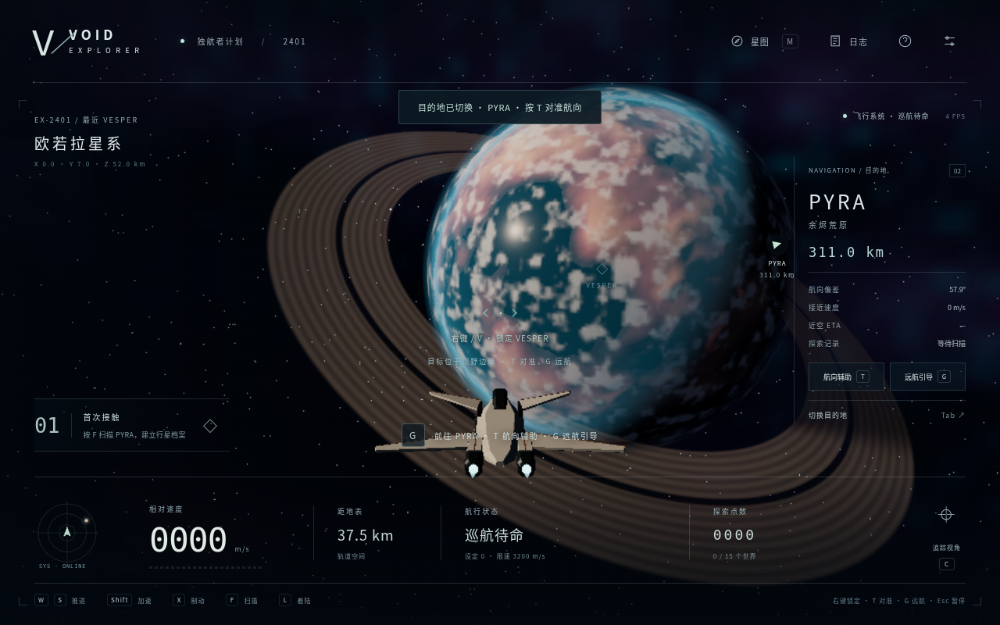
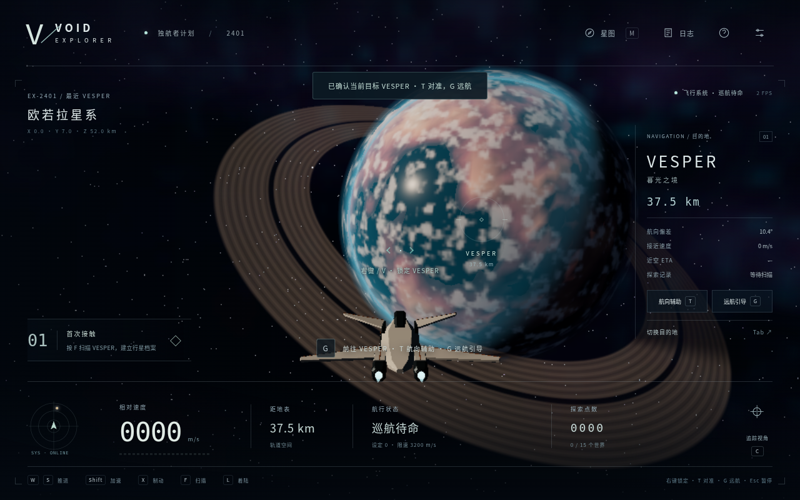

# 右键目标锁定修正

基线为 AURORA 集成提交 `793eacd`。用户反馈：已经捕获鼠标、用中央准星瞄准，右键后完全没有提示。

## 观察与判断

云端 Chromium 154 中，普通右键在捕获状态可以成功锁定，见 [捕获状态基线](right-click/locked-before.json)。因此不能声称已经在用户的具体浏览器上复现同一原因。

同时实际复现了两条缺陷，见 [基线记录](right-click/before.json)：自由鼠标右击未选中星球的标签时，事件落在 HUD 按钮上，旧 canvas 监听器没有收到，目标不变且没有锁定提示；自由鼠标右击空白太空时，旧代码仍查询中央射线，错误地选中了中央行星。

另有一条会产生“已捕获却没有提示”的路径：着陆和步行状态可以捕获鼠标，但旧锁定代码遇到非飞行状态直接返回，没有解释。修正后用明确的地面测试场景验证了起飞提示；这并不证明用户当时一定处于该状态。

## 修改

- 在 document 捕获阶段处理游戏内次级按键，兼容 pointerdown、鼠标事件、Control-click 和仅 contextmenu 的路径，并对同一次物理点击去重。UI 面板和暂停输入仍不触发目标选择。
- 捕获鼠标时以中央准星射线选星球；自由鼠标时以实际画布坐标选星球，右键标签也能选择。射线仍保留原有物理距离/遮挡判定，没有改动飞行或巡航参数。
- 新增 **V**：始终锁定中央准星目标，作为鼠标事件无法正常传入时的替代输入；不占用原有 Q/R 横滚键。
- 准星下显示候选行星名称，可锁定时准星变绿。选中同一目标会显示“已确认当前目标”；未命中、已着陆、步行及过渡状态都有对应提示。目标面板立即更新。
- 开发态快照新增 `targeting.attempts`、`lastAttempt` 和 `reticleCandidate`，便于区分“没有收到操作”和“收到操作但未命中/状态不允许”。生产版本仍不暴露测试接口。

## 玩家操作

1. 确保处于自由飞行；步行时先 E 登船，再 Space 起飞。
2. 点击画面捕获鼠标，用中央准星对准行星，观察准星下的候选名称。
3. 按右键或 V 选定；右侧面板显示目的地。T 辅助对准，G 启动远航引导。
4. 未捕获鼠标时，也可直接右键点击行星或其标签；Tab 和星图选择继续可用。

## 验证与限制

`npm run test:right-click` 使用正常出生点、真实键盘/鼠标与真实 pointer lock，覆盖空白区域、标签、行星像素、捕获后右键、Control-click、V、确认当前目标、未命中和暂停。仅 contextmenu 的兼容分支使用明确标记的合成 MouseEvent；非飞行提示使用明确标记的 `step(14)` 地面定位，不能当作玩家真实下降证据。见 [十组检查报告](right-click/report.json)。

另外复用逻辑、导航和生产检查；生产检查新增真实 V 及捕获后右键选择，继续验证 GLB 校验和开发接口隔离。CI 持续运行完整原有套件。Windows/macOS 上用户具体浏览器或外层宿主截获鼠标事件的原因仍未远程证实，V 是独立可用的输入路径。

发布时更新 `/aurora/` 入口，并将上一版完整保存在 `/aurora-793eacd/`；源码 SHA、最终 CI 和部署结果记录在 PR 与在线 `build-info.json`。默认第二轮入口及此前归档保留。
