# 第三轮：渲染升级与视觉验证

基线：第二轮源码 `45cd89ce0a190c9f8973e281e78127970eaf5edd`。本轮分支为 `feat/rendering-round3`，依赖第二轮分支，不合并或重写前两轮的提交、PR 或发布历史。

## 原有问题与证据

参考 Showcase 页面成功访问，只用于理解视觉目标；没有复制其源代码，也没有将回顾流程作为要求。检查了现有 WebGL 着色器、第二轮运行截图和测试，然后在改动前采集了本轮的固定场景基线。

- 所有天体使用同一个朝向原点的平行光，大气却按各行星到恒星的方向计算，尤其远处行星的明暗与大气并不一致。
- 强半球环境光冲淡昼夜差异；云层基本不受恒星照明，夜面仍呈亮白块。地表、云层和大气缺少一致的层次。
- 海洋使用偏高金属度，产生明显的亮斑；地表像素 hash 和固定频率条纹缺少距离过滤，近远观察容易爬动。
- 地形每半秒同步移除/重建细分块，没有过渡或生成预算；既有“裙边”能遮缝，但不能消除形状跳变与生成峰值。
- 透明自定义材质拥有纹理时，原生命周期没有统一释放这些纹理。

八组基线与改后画面均使用 1280×800、DPR 1、中档画质，固定同一船体位置、姿态和镜头 FOV。`before` 已加入共同的冻结/观测工具，但未修改原有光照和材质；因此不是凭不同角度截图推断效果。

## 实际修改与方案选择

继续使用 Three.js / WebGL 2。当前材质和对数深度基于 GLSL，迁移 WebGPU/TSL 会扩大范围和兼容风险；本轮**没有实现或宣称 WebGPU 后端**。

1. 恒星改为真实位置的点光源与平方反比衰减；低强度环境光保留暗处基本可读性。飞船、云层和星环采用有限恒星角尺寸的解析天体遮挡近似。地表自身昼夜由真实点光源的法线照明产生；没有宣称完整阴影映射或地形自阴影。
2. 保持现有线性 HDR、ACES 和最终输出转换。统一恒星颜色来源，降低背景亮度以突出主体；未加入自动曝光，避免跨场景曝光跳变。
3. 地形使用预生成、可重复且带 mipmap 的多频岩石纹理，三平面采样、连续岩层配色和有上限的微法线。细节随观察高度平滑减弱，远处跳过无意义的微细节计算；不改变程序化地表高度、世界种子或碰撞算法。
4. 海洋采用非金属、IOR 1.33 的介电材质，收敛粗糙度与镜面强度，增加球面采样密度。云层改为带 mipmap 的种子纹理，具有恒星照明、夜面衰减和两侧可见的薄层；掠射方向及穿过云壳时渐隐，避免突兀白线和单面消失。
5. 大气采用球壳光路上的少量密度采样，表达近似的 Rayleigh/Mie 相位、日照与暮光；地表雾密度随海拔及日照连续变化。低/中/高分别采用 2/3/6 个大气采样点，仍为风格化近似，不是完整物理散射或体积云。
6. 地形增加父块覆盖、位置/法线渐变、细分迟滞、缓存和分帧生成。每帧最多生成 8 块，采用约 8 ms 的软预算；单块计算及其他更新可能让墙钟时间超过预算，不宣称硬性 8 ms 上限。海洋及地形网格密度提高，因此三角形数量增加。生成器改用预分配数组和复用向量，移除新材质不再使用的逐顶点颜色计算，减少生成时的临时对象。
7. 统一材质纹理释放，保留共享岩石纹理，减少切换场景后的无主 GPU 资源。飞船只调整现有材质，未重新设计模型。

直接相关的修复：固定场景的镜头 snap 同时同步 FOV，导航标记投影前同步当前相机矩阵；排除不可见缓存父块后继续用原有 0.09 引擎单位的射线精度断言；限制掠射角下可能过强的微法线扰动。没有添加星系、遗迹或新游戏机制。

## 同机位视觉比较

每张图片可单独打开检查原图。完整状态、帧数据和控制台错误记录在 [改动前报告](round3/before/report.json)、[改动后报告](round3/after/report.json) 和 [对比数据](round3/comparison.json)。

| 场景     | 第二轮基线                                     | 第三轮                                        |
| -------- | ---------------------------------------------- | --------------------------------------------- |
| 轨道     | 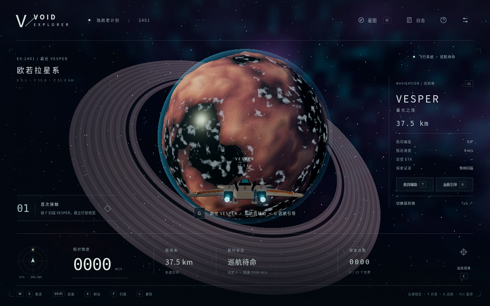      | 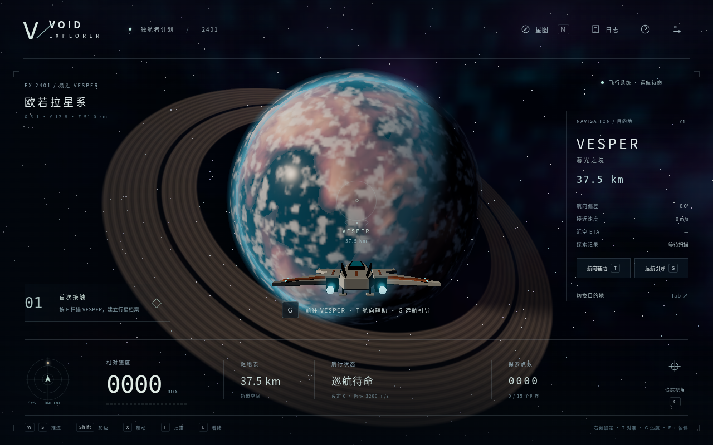      |
| 昼夜交界 | 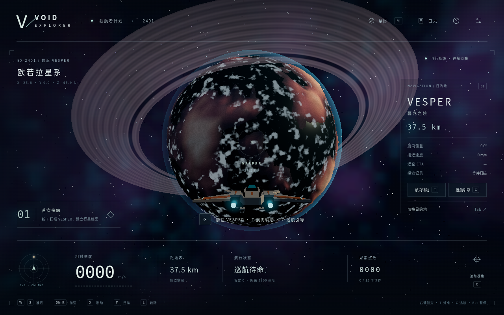 | 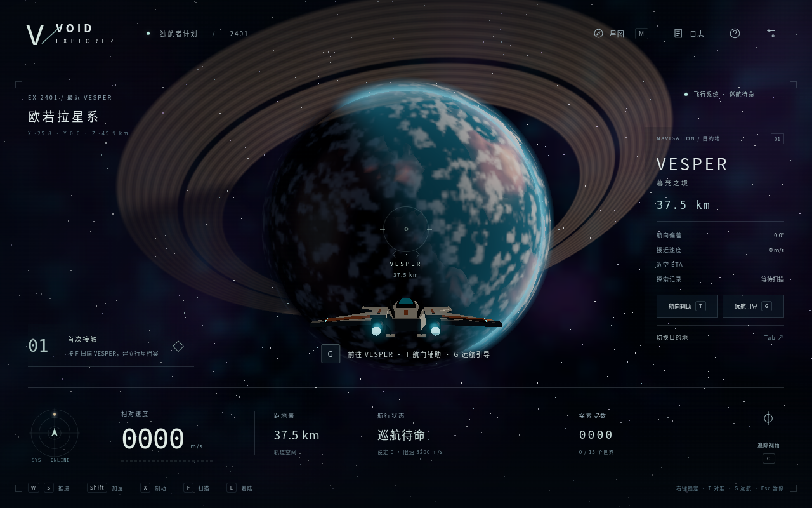 |
| 夜面     | 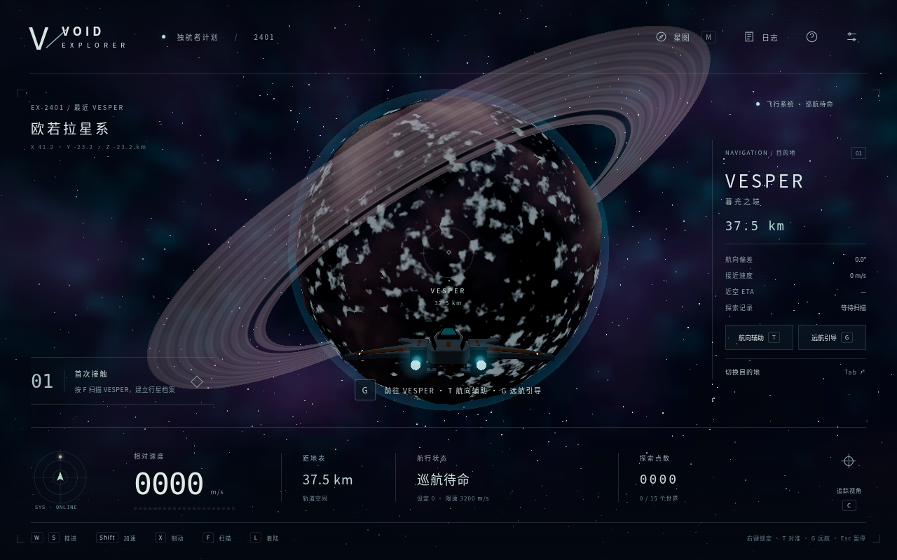      | 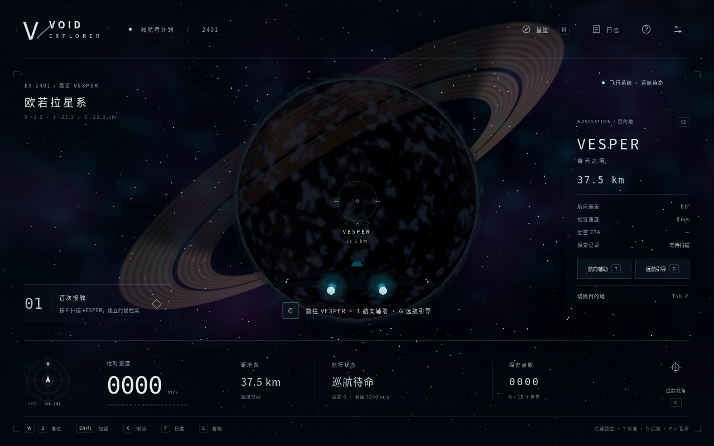      |
| 荒漠行星 | 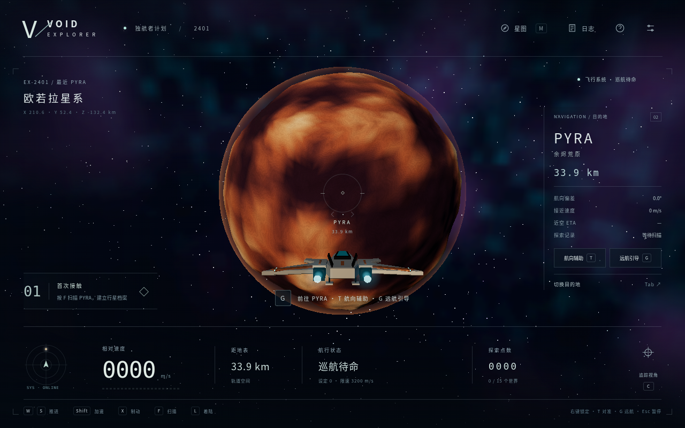     | 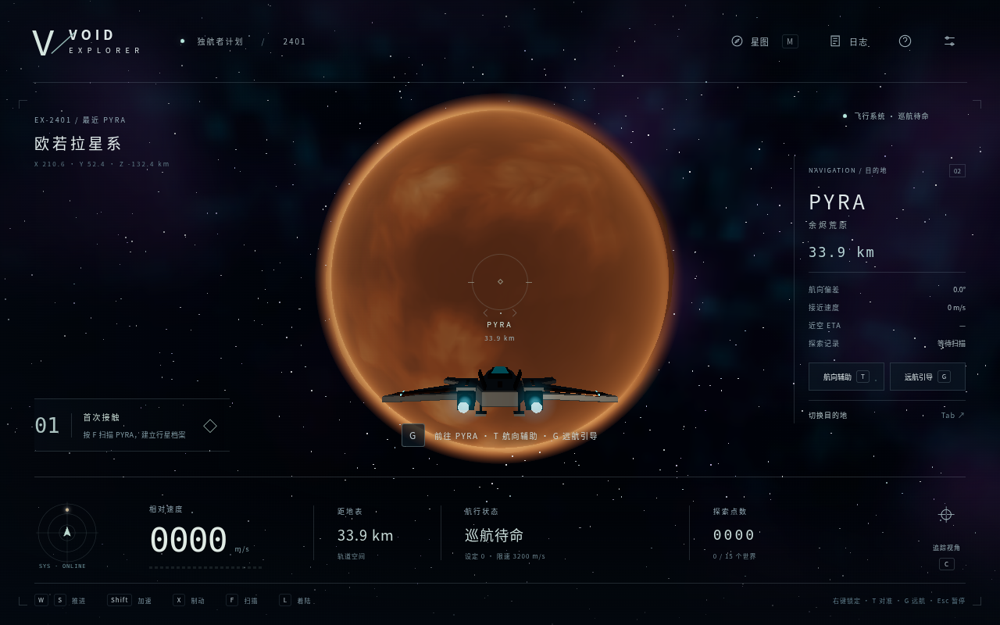     |
| 行星近景 | 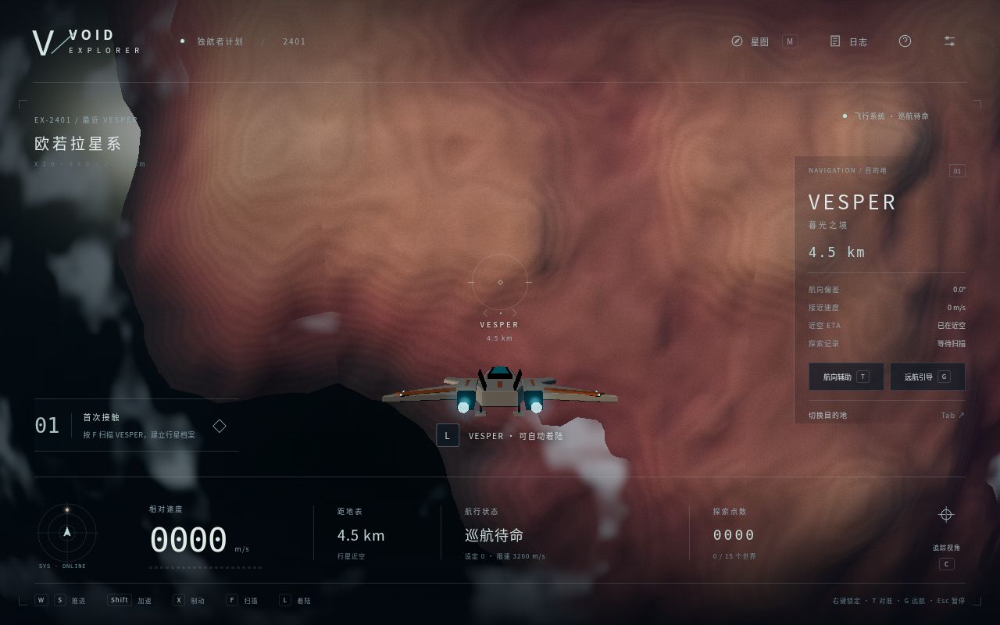       | 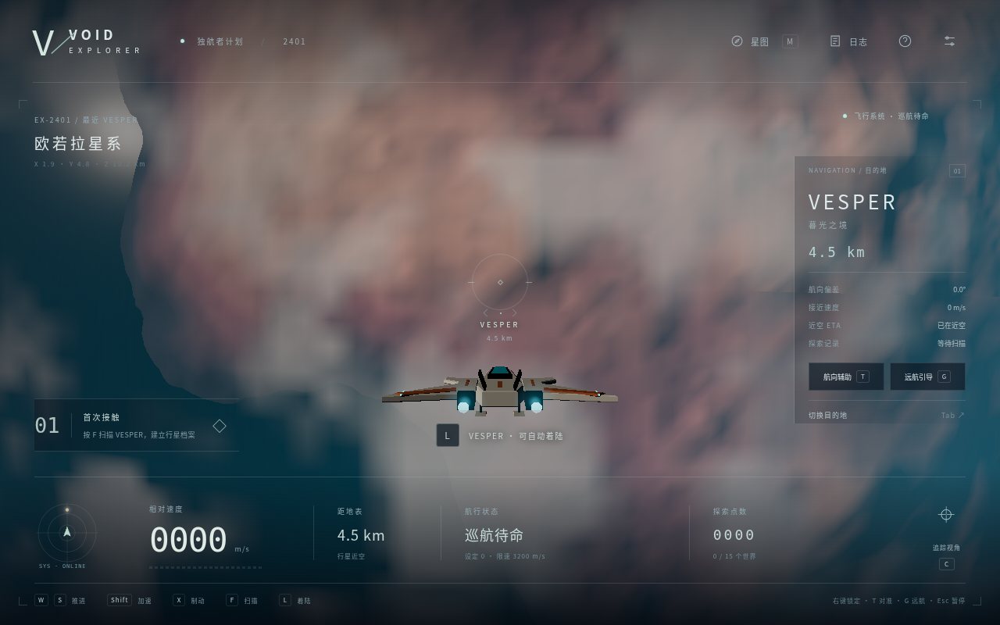       |
| 大气内   | 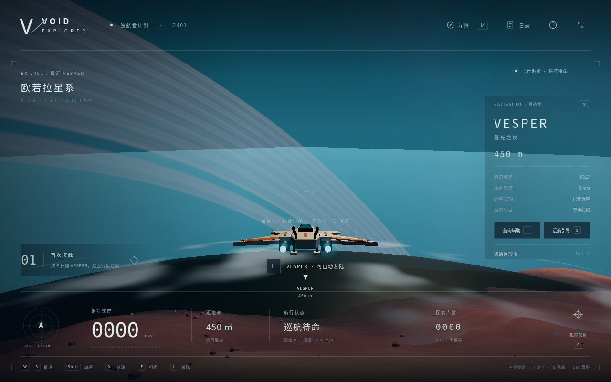 | 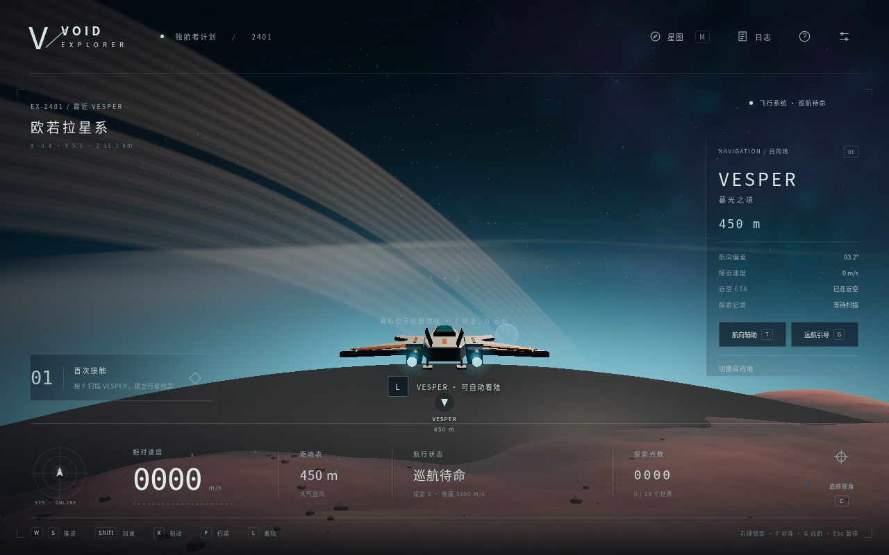 |
| 地表     | 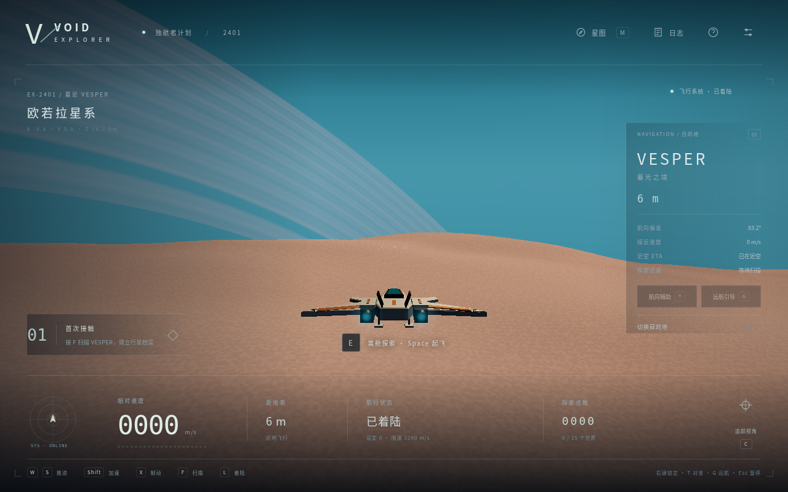    | 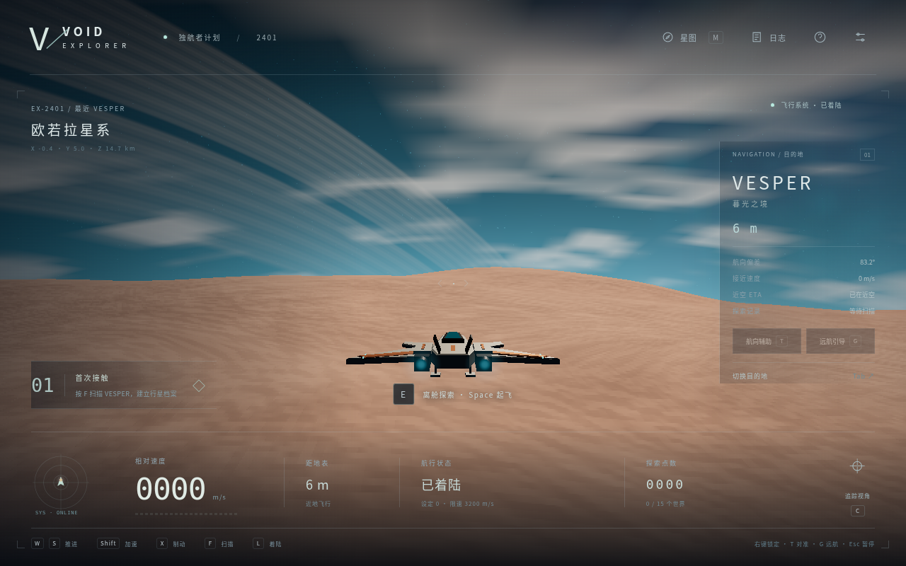    |
| 高速姿态 | 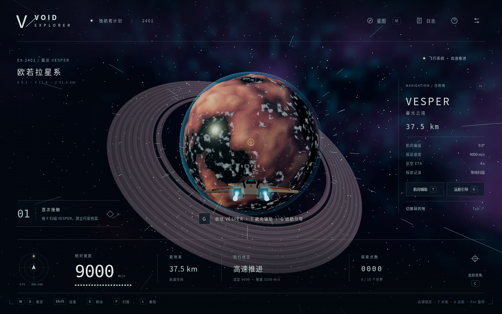     | 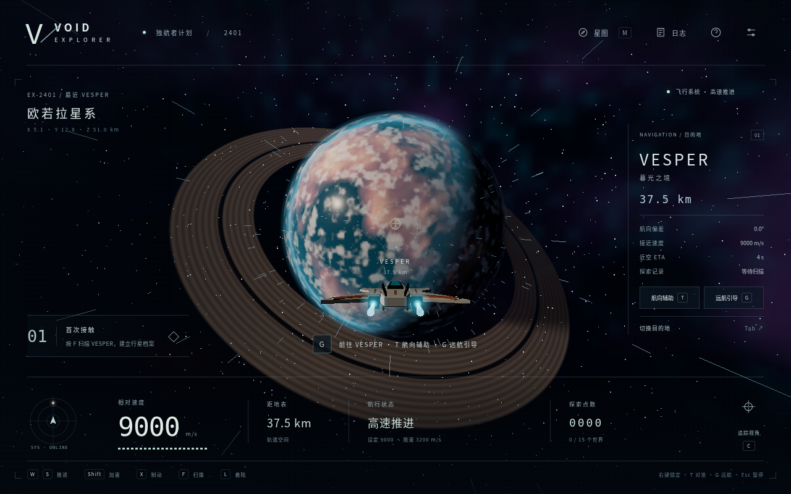     |

静态画面对比新增的 `freeze()` 只在开发测试入口中冻结物理/视觉时间。沿用第二轮场景 API，并扩充 `render-*` 场景、CPU/渲染提交/帧间隔指标、地形队列和渐变计数。静态测试强制完成一次细分再等待 12 帧暖机，最后记录 8 个样本，避免将位置或加载状态差异当作画面差异。

## 实际游玩与回归

- 原有探索循环、导航和生产冒烟套件继续使用真实键鼠、星图、暂停、存档及浏览器截图。
- 新增真实时间下降检查：正常出生点 → L 着陆 → 地形队列/渐变 → E 离舱 → F 采样 → E 登船 → Space 起飞。没有通过场景定位或 `step()` 代替这一过程。
- 该次真实流程记录 93 个样本，单帧生成块数最多 8，观察到的更新峰值约 47.0 ms。加载收敛后的渲染/碰撞半径差约 0.000222 引擎单位，即约 0.0022 m；这是该点的观测值，不是对全部行星地形的精度保证。
- 另保留三颗行星高地的可见网格射线测试，阈值仍为 0.9 m；缓存父块不参与“实际绘制表面”的射线断言。
- 新逻辑测试覆盖真实恒星位置、光照遮挡、大气连续衰减、夜雾、生成预算、父子覆盖与迟滞。冻结场景不算玩家真实航行完成证据。

[真实下降截图](round3/real-descent.png)、[真实着陆截图](round3/real-landed.png)、[真实流程状态轨迹](round3/real-flight-report.json)。

云端运行命令：

```bash
npm run dev -- --port 5173
# 另一云端终端
npm test
npm run test:e2e
npm run test:navigation
npm run test:rendering
npm run test:render-flight
npm run build
# 另起 npm run preview -- --port 4173 后：
npm run test:production
```

生成对比基线使用 `VOID_VISUAL_STAGE=before npm run test:rendering`；正常第三轮代码只应生成 `after`，不要覆盖已归档的第二轮基线。

### 独立复现第二轮渲染基线

`tests/render-baseline.patch` 仅给第二轮源码添加相同的冻结、场景和观测工具，不包含新光照/材质。已检查它能应用于固定基线提交。可在云端独立工作树复现：

```bash
git worktree add --detach /tmp/void-render-baseline 45cd89c
git -C /tmp/void-render-baseline apply /workspace/void-explorer/tests/render-baseline.patch
cd /tmp/void-render-baseline
npm ci --cache /tmp/void-npm-cache
npm run dev -- --port 5174
# 从当前项目目录的另一云端终端运行：
VOID_URL=http://127.0.0.1:5174 VOID_VISUAL_STAGE=before npm run test:rendering
```

## 性能观测与限制

所有数据来自 Linux 云端 Chromium 154，强制 ANGLE SwiftShader 软件渲染；没有真实 Windows/macOS GPU 结果。CPU 更新/提交耗时不等于 GPU 执行耗时，RAF 间隔还包括驱动、光栅化、呈现和调度。每场景 8 个稳定样本只是小样本观测，不作为硬件性能验收。

| 固定中档场景 | 基线 RAF 中位数 | 第三轮 RAF 中位数 |
| ------------ | --------------: | ----------------: |
| 轨道         |          367 ms |            450 ms |
| 昼夜交界     |          417 ms |            417 ms |
| 夜面         |          350 ms |            483 ms |
| 荒漠         |          317 ms |            333 ms |
| 近景         |          450 ms |            683 ms |
| 大气内       |          383 ms |            633 ms |
| 地表         |          433 ms |            683 ms |
| 高速姿态     |          350 ms |            533 ms |

这些软件数据说明本轮视觉有额外成本，**不能声称性能普遍提升或桌面浏览器已流畅验收**。近景和大气在此环境仍较慢；采样中的主线程更新中位数约 0.7–1.4 ms，不能据此忽略明显更大的帧间隔。低画质减少像素密度、大气采样并关闭泛光。实体 GPU 的真实帧时间、显存和功耗测试仍是发布质量判断的必要后续工作。

## 尚未完成与后续建议

- WebGPU 双后端、深度感知的全屏大气合成、完整体积云、地形自阴影、飞船自身动态阴影和全局反射均未实现。
- 大气以参考球面近似光路，高山边缘可能有额外薄雾；云是薄层，局部穿越仍是渐隐近似。海面没有真实浪形几何。
- 几何与材质增加了渲染负担，长期运行、Safari/Firefox、所有夜间着陆与任意镜头组合尚未全面验证。
- 下一步优先实体 GPU 分析，再决定抗锯齿、合批/剔除和质量预算；随后完善深度感知散射、云层和阴影。若确有收益再评估 WebGPU 材质迁移。

第三轮使用独立 [在线预览](https://mkc-mankii.github.io/void-explorer/round3/)，默认入口继续保留第二轮，第一轮归档也保留。实际源码 SHA 和 PR 记录在预览的 [build-info.json](https://mkc-mankii.github.io/void-explorer/round3/build-info.json)；这是一份有上述性能限制的渲染预览，不代表桌面硬件完整验收。
